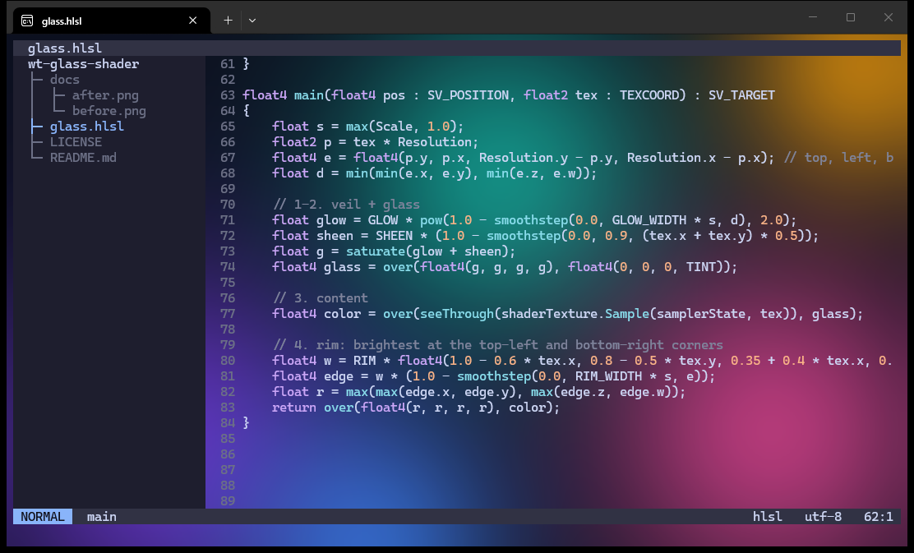
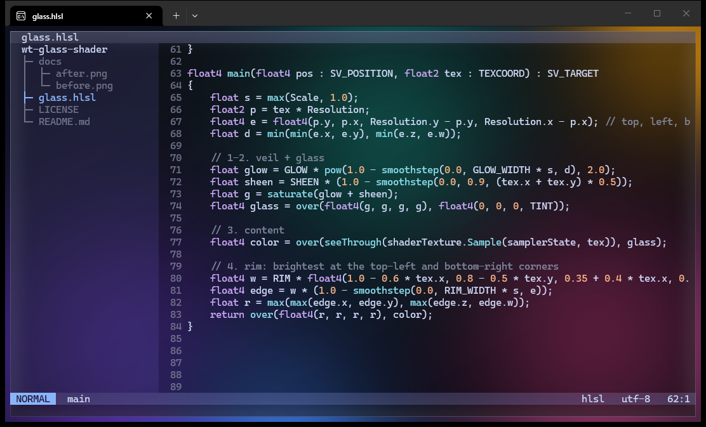

# wt-glass-shader

A pixel shader for Windows Terminal that gives the window a glass look over acrylic or a background image. It also makes the cell backgrounds that TUI programs paint (nvim themes, btop, lazygit panels) see-through, so the backdrop shows behind them too.

| Without the shader | With `glass.hlsl` |
| --- | --- |
|  |  |

Both screenshots use the same profile with a background image. Window captures do not include the acrylic blur of the windows behind the terminal, so the preview uses a generated gradient instead.

## What it does

- Lays a black veil over the window. Acrylic over a dark scheme does not get darker than about `#222222` on its own; with the veil an empty area lands near `#101010`.
- Turns opaque cell backgrounds into translucent layers by color-to-alpha against `BG`. Over an empty area a panel looks as it does without the shader, apart from the glow and sheen under it. Over an image or acrylic, the backdrop shows through in proportion to how close the panel color is to `BG`. Cells at or below the brightness of `BG` become fully transparent, while text and bright bars stay opaque.
- Draws a 1.25 px highlight on the window edge (brightest at the top-left), a 48 px glow along the edges and a faint diagonal sheen from the top-left corner.

The shader never reads `Time`. Windows Terminal checks this when it compiles a shader (`_requiresContinuousRedraw` in [`BackendD3D.cpp`](https://github.com/microsoft/terminal/blob/main/src/renderer/atlas/BackendD3D.cpp)) and redraws every frame only for shaders that use it, so this one costs a frame only when the content changes.

## Install

Save `glass.hlsl` anywhere and add this to `settings.json`:

```jsonc
"profiles": {
    "defaults": {
        "experimental.pixelShaderPath": "C:\\path\\to\\glass.hlsl",
        "useAcrylic": true,
        "opacity": 40,
        "scrollbarState": "hidden"
    }
}
```

`opacity` sets how much of the blurred backdrop comes through. At 92 it barely shows: an empty area varied by 4 brightness levels out of 255 in my test. Lower values let more through.

The shader only covers the text area. A visible scrollbar leaves a gutter (17 px at 100% scaling) that the veil does not reach, which shows up as a lighter strip on the right. `"scrollbarState": "hidden"` removes it; the mouse wheel still scrolls.

Windows Terminal loads the shader when a tab opens and when `settings.json` is saved. If it fails to compile, the Terminal shows a warning and ignores it until the next load.

## Tuning

All constants are at the top of `glass.hlsl`.

| Constant | Default | Effect |
| --- | --- | --- |
| `TINT` | `0.53` | Opacity of the black veil. Higher is darker. |
| `BG` | `#101010` | On-screen color of an empty area after the veil. See below. |
| `GLOW_WIDTH`, `GLOW` | `48` px, `0.07` | Width and strength of the glow along the edges |
| `SHEEN` | `0.035` | Strength of the diagonal sheen |
| `RIM_WIDTH`, `RIM` | `1.25` px, `0.45` | Width and peak brightness of the edge highlight |
| `SOLID_FROM`, `SOLID_TO` | `0.25`, `0.60` | Layers more opaque than this range (text, bright bars) are pushed to fully opaque |

### Setting `BG`

With acrylic and a background image on, Windows Terminal passed `Background = (0,0,0,0)` to the shader in my tests, so the shader cannot read the scheme color. `BG` has to be the color an empty area actually has on screen. With acrylic that is roughly the acrylic color times `1 - TINT`: acrylic averaged `#222222` in my setup, and `0x22 × 0.47 ≈ 0x10`.

After changing `TINT`, pick the color of an empty area with a color picker (PowerToys Color Picker works) and put it into `BG`. If `BG` is off, dark panels come out slightly lighter or darker than the empty background around them.

## Tested on

Windows Terminal 1.24.12741.0 on Windows 11 build 26200, at 100% display scaling. Edge widths are multiplied by the `Scale` value the Terminal passes in; other scaling levels are untested.

In a full-screen redraw test (a script rewriting 38 lines of 140 columns as fast as ConPTY accepts them, in a maximized 2560×1440 window on an RTX 5080), throughput with the shader was within 1% of no shader: 5158 to 5193 frames per second against 5197 to 5243, three runs each.

## License

[MIT](LICENSE)
